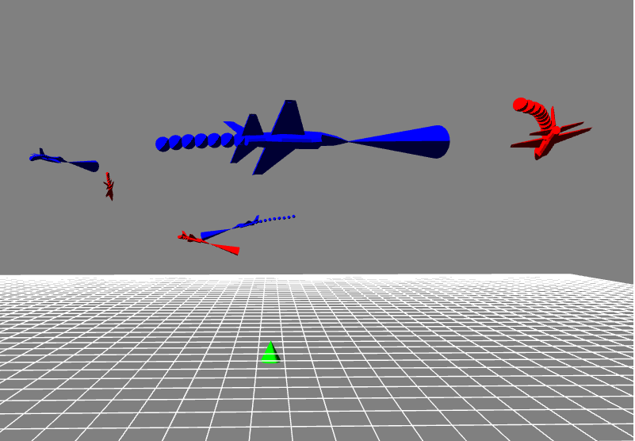
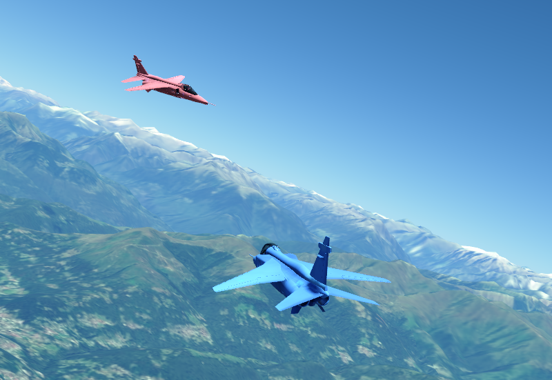

# Hierarchical Multi-Agent Reinforcement Learning for simulated Air Combat
3D Heterogeneous Hierarchical MARL for realistic Air Combat Simulation. This is the official implementation of [this paper](https://arxiv.org/pdf/2510.11474). This project is a continuation of the 2D Hierarchical MARL Air Combat model found [here](https://github.com/IDSIA/hhmarl_2D).

<p align="center">
  
  
</p>

## Learning Procedure
Training proceeds in two stages on top of a JSBSim-based flight dynamics environment:

1. **Low-level curriculum.** Single skills (`cannon`, `track`, `escape`) are learned with a difficulty curriculum (levels `L1`–`L4`). Each level increases opponent strength and initial-state randomization, restoring the policy from the previous level. The agents output low-level flight controls (`hierarchy_level=1`).
2. **High-level hierarchy.** A commander policy (`hierarchy_level=2`) is trained on the `"hier"` config. At each high-level step it assigns one of the pre-trained low-level policies to every aircraft, which is then rolled out for several simulation steps. The commander learns to coordinate the team against pre-trained opponents.

Policies are trained with on-policy MARL (shared actor, centralized critic). While the paper presented results for MAPPO and MASPO that were based on Ray RLlib, the code meanwhile features it's own implementation of [MAPPO](https://arxiv.org/pdf/2103.01955), [MASPO](https://arxiv.org/pdf/2401.16025) and the recently presented [MARS](https://arxiv.org/pdf/2605.09212) algorithm. Results from the paper may therefore slightly differ, but overal learning is more stable compared to the Ray version. Checkpoints and TensorBoard logs are written to `runs/<task>_<model>_<run_name>/`.


## Running Instructions
All settings are defined in [`args.py`](args.py) and passed as command-line flags. A few experiment-specific overrides (batch sizes, learning rates, algorithm) are applied in `process_args` of [`train.py`](train.py).

### Low-level curriculum training
Set `hierarchy_level=1`, pick the skill (`task`) and the curriculum `level`:
```bash
python train.py --task track --level 1
```
Curriculum learning is **manual**: train each task through every level in order, and for each new level restore the checkpoint of the previous level yourself via `--restore_path`:
```bash
python train.py --task track --level 2 --restore_path runs/track_L1_f16_<run_name>
python train.py --task track --level 3 --restore_path runs/track_L2_f16_<run_name>
# repeat for task cannon and escape.
```
**NOTE:** At the highest difficulty of each skill (L4 `track`, L4 `cannon`, L2 `escape`), opponents follow a *mixed* strategy drawn from the pre-trained lower-level policies. You must therefore train the preceding levels first, i.e. L3 `track`, L3 `cannon`, and L1 `escape`, before starting these. See also the *Key arguments* below.

### High-level hierarchical training
Set `hierarchy_level=2` and `task=hier`:
```bash
python train.py --task hier --hierarchy_level 2
```
The commander uses the pre-trained low-level policies of level 4. The opponent strategy is configured in [`env/configs/hier.yaml`](env/configs/hier.yaml) (`opp_hier_strategy: mixed | aggressive | random`).

### Inference
Set the run directory and matching task/level arguments, then run:
```bash
python test.py
```
This evaluates over many episodes and reports mean win/loss rates. 

### Rendering
The scene is rendered in PyGame by default (left image). Rendering can be disabled by setting `RENDER` in [`test.py`](test.py) to `False`. The more realistic renderer (right image) is [FlightSim](https://github.com/ardian-selmonaj/FlightSim), based on [Skybolt](https://github.com/Prograda/Skybolt/tree/master), which is selected with `RENDERER = "flightsim"` in [`test.py`](test.py). Training never uses FlightSim.

FlightSim is a separate repository: clone it next to this repository (or set the environment variable `FLIGHTSIM_DIR` to its folder) and set it up as described in its README, which builds the `skybolt` Python module for Python 3.11, so the venv of this repository needs Python 3.11 as well. FlightSim is only imported when it is used ([`rendering/flightsim.py`](rendering/flightsim.py)). The other settings of [`test.py`](test.py):

| Setting | Meaning |
|---|---|
| `LOCATION` | (longitude, latitude) of the battle field center, e.g. Lugano. The initial states of the configs keep their offsets from the center. |
| `INIT_STATES` | initial state per aircraft, relative to the center (`north`/`east` in m, `alt`, `speed`, `heading`, optionally `roll`/`pitch`), or `None` for the configs (also used with PyGame) |
| `JSBSIM_STATES` | `"python"`: the JSBSim of this env simulates the aircraft and FlightSim shows them, `"c++"`: the JSBSim of FlightSim simulates them. Both use JSBSim 1.3.0 at `sim_freq` (75 Hz). |
| `MANUAL`, `MANUAL_AGENT` | a human flies `MANUAL_AGENT` with the joysticks of FlightSim's `Tools/joysticks.json` (e.g. HOTAS Warthog and pedals) or the keyboard (mission `model_human`), as teammate of the blue RL agents. Its F-16 has the corrected rudder of FlightSim's `Assets/Movers/JSBSimManual` in both JSBSim modes, while the RL agents keep the F-16 of their training (see the TODO in the FlightSim README). It is added as copy of `B1` if the config has no such aircraft (e.g. `B2` with `track`/`cannon`/`escape`), otherwise it replaces the RL agent (e.g. `B3` with `hier`, where the commander observes the human as friendly). |
| `MINIMAP`, `MINIMAP_RANGE` | map of the aircraft around the camera target in the bottom right corner of the FlightSim window: arrows in the team colors pointing in their headings, with their IDs and distances (3D) to the camera target (e.g. `7.3 km`), and small dots along the paths of the other aircraft in the last 30 s. In the free view (F4), a light gray camera with dashed lines along its field of view shows where the camera looks. `MINIMAP_RANGE` (m, default 20 km) is the radius of its outer ring (the dashed ring is at half of it); aircraft farther away are shown on the ring in their direction, with their distance. It is heading-up with `MANUAL`, otherwise north-up. |
| `WEZ` | weapon engagement zones (WEZ) of the cannons in the cockpit and follow views (F1, F2) of the FlightSim window, key Z toggles them: a light green circle ahead of the camera target while an opponent (an aircraft of the other team) is in its WEZ, so that firing would make sense, and a red beam like a flashlight from each opponent that has the camera target in its WEZ to the camera target, most opaque at the opponent (at the edge of the window in its direction if it is out of view) and fading out towards the camera target; for an opponent nearly behind the camera it turns into a red border around the window. The WEZ is the one of `CannonSim`: within `omega_wez` (10 degrees) of the velocity and `Rmax_wez` (3500 m). |

The policies always act every `sim_steps` JSBSim steps as in training, and FlightSim shows the aircraft in real time after every JSBSim step. With FlightSim, the aircraft of the hierarchical env are simulated in lockstep (all aircraft set their controls, then all advance together) instead of one after another. Labels show the aircraft IDs (e.g. `B1`, `R2`) and trails the last 30 km flown, in the team colors. The engine nozzles of the aircraft in view (the camera target) glow from black at idle to dark red at full throttle. Keys: F1 cockpit, F2 follow, F3 overview of all aircraft (the default without `MANUAL`; the mouse rotates around them and its wheel zooms, also A/D and W/S unless they fly the manual aircraft), F4 free camera (W/S and A/D move it, holding Shift 10 times faster, holding Ctrl 10 times slower), Tab next aircraft (also the center of the minimap), L labels, T trails, M minimap, N minimap north-up/heading-up, Z weapon engagement zones, R start/stop recording, V vsync on/off, B full screen on/off, H help, Esc exit. Manual flight: the joystick, throttle and pedals of FlightSim's `Tools/joysticks.json` while they are connected (the cannon fires exactly while the trigger is held, unlike the one of the RL agents, see the TODO in the FlightSim README), otherwise the keyboard: Up/Down pitch down/up, Left/Right roll, A/D rudder, W/S throttle, Space cannon. See the FlightSim README for the mapping of the devices.

R records the view of the FlightSim window (the selected camera, with labels, trails, minimap and weapon engagement zones if shown, but without the help message and the red dot in the top left corner that shows the recording) into a new MP4 file in `recordings/`, until R is pressed again or FlightSim is closed. The video has 30 frames per second of simulated time, so it plays at the real speed of the simulation. Frames of the video are never skipped, so on a PC that renders slower than that, the simulation runs slower than real time while recording. The video is encoded by the ffmpeg of the `imageio-ffmpeg` package of `requirements.txt`.

### Key arguments
Besides others, the most important configuration arguments of [`args.py`](args.py) are the following:

| Argument | Meaning | Accepted values |
|---|---|---|
| `task` | environment task | `track`, `cannon`, `escape`, `hier` |
| `level` | curriculum difficulty | `1`–`4` (`track`/`cannon`), `1`–`2` (`escape`) |
| `hierarchy_level` | training stage | `1` (low-level control), `2` (high-level commander) |
| `algorithm` | policy optimization objective | `ppo`, `spo`, `mars` |
| `rnn` | add a GRU layer to actor/critic for recurrence | `true`/`false` |
| `attention` | add a cross-agent attention layer to the actor (mutually exclusive with `rnn`) | `true`/`false` |
| `cuda` / `cuda_id` | GPU usage / device index | `true`/`false`, integer |

**Heterogeneous setups:** the aircraft model is set per aircraft in the YAML configs ([`env/configs/`](env/configs/)). Set `model: f16` or `model: A4` (uppercase A, otherwise error) to mix aircraft types within a team or across teams. The model is also folded into the run/log name (`runs/<task>_<model>_<run_name>/`).

**Base actors:** a pre-trained base actor, i.e., an aircombat agent trained to pursue a fixed goal, is taken from the [LAG environment](https://github.com/liuqh16/LAG/tree/master), that serves as our scripted agent during levels L1 and L2. The [`catalog.py`](env/catalog.py) containing JSBSim properties is also borrowed from LAG. 


## Cite

```bibtex
@inproceedings{selmonaj_aircombat,
  title={Coordinated Strategies in Realistic Air Combat by Hierarchical Multi-Agent Reinforcement Learning},
  author={Selmonaj, Ardian and Del Rio, Giacomo and Schneider, Adrian and Antonucci, Alessandro},
  booktitle={2025 IEEE International Conference on Agentic AI (ICA)},
  pages={12--17},
  year={2025},
  organization={IEEE}
}
```
